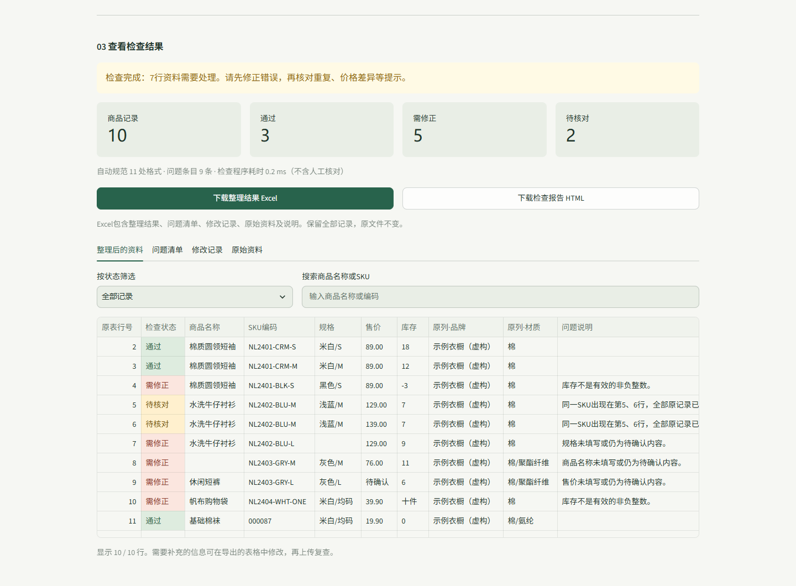

# 商品资料整理与检查

一个本地运行的电商商品资料维护工具。上传 Excel 或 CSV，自动统一明确的格式、定位常见问题，再导出保留原始资料的结果和检查报告。



## 能做什么

- 识别常见列名，也可手动确认商品名称、SKU编码、规格、售价、库存各自对应哪一列。
- 统一首尾空白、全角数字、明确的货币符号及数值格式。
- 检查必填项缺失、重复SKU、同一SKU售价差异、无效售价及异常库存。
- 区分“通过”“需修正”“待核对”，支持筛选、搜索及逐行定位。
- 保留SKU前导零、原始值、额外列和全部重复记录，提供修改日志。
- 下载五页Excel结果或可离线打开的HTML报告。
- 内置10行明确标注为虚构的演示资料，可直接体验。

## 快速开始

需要 **Python 3.11及以上版本**，已在Windows与Python 3.12中验证。

1. 通过 GitHub 的 **Code → Download ZIP** 下载并解压，或克隆仓库。
2. 双击 **启动工具.cmd**。
3. 首次启动会在项目目录创建 `.venv`，并联网安装 `requirements.txt` 中的依赖；后续直接复用该环境。
4. 浏览器打开后，点击 **载入演示数据 → 开始整理与检查**。

命令行启动也可以：

```powershell
python launch.py
```

程序只监听本机，默认地址为 `http://127.0.0.1:8501`。端口被占用时会自动选择后续空闲端口，实际地址显示在启动窗口。保留启动窗口即可继续使用，按 `Ctrl+C` 停止。

## 使用自己的商品表

第一行为列名，每行一个SKU，来自同一店铺、同一时间和价格口径。可以在工具中下载空白Excel模板。

| 标准字段 | 示例 | 要求 |
| --- | --- | --- |
| 商品名称 | 棉质圆领短袖 | 必填 |
| SKU编码 | `000087` | 建议使用文本单元格，保留前导零 |
| 规格 | 米白 / M | 必填 |
| 售价 | 89.00 | 正数，最多两位小数；不同价格类型分别保留 |
| 库存 | 0 | 非负整数，零库存有效 |

支持 `.xlsx` 和 `.csv`，单次最多 **5MB、5000行、80列**。Excel可选择可见工作表；CSV支持UTF-8/BOM与GB18030。

下载的结果Excel包含 **整理结果、问题清单、修改记录、原始资料、说明** 五张表。按来源修正后，可以再次上传“整理结果”页复查。

## 处理范围

上传资料在当前会话内存中处理，不覆盖源文件，也不自动写入店铺。缺失的价格、库存和存在矛盾的信息会标出供人工确认，不根据其他商品猜测。

“通过”表示符合本工具的通用检查规则，不能证明售价、库存真实，也不替代平台类目、资质及发布审核。Excel公式不会执行，数字类型SKU会提示核对可能丢失的前导零。

## 开发与验证

技术栈：Python、Streamlit、pandas、openpyxl。应用依赖固定在 `requirements.txt`。

```powershell
python -m venv .venv
.\.venv\Scripts\python.exe -m pip install -r requirements.txt
.\.venv\Scripts\python.exe -B -X utf8 -m unittest discover -s tests -v
```

首版已通过50项测试，覆盖文件读取、字段对应、检查规则、导出重读与页面状态。浏览器验收另覆盖实际上传、下载、导出后复查、筛选、错误恢复及375px布局，详见[验收记录](docs/验收记录.md)。

运行浏览器验收需要另外安装开发依赖，并先启动工具：

```powershell
.\.venv\Scripts\python.exe -m pip install -r requirements-dev.txt
.\.venv\Scripts\python.exe tests\browser_check.py
```

浏览器脚本使用电脑上已安装的Google Chrome，不需要访问真实店铺。临时文件与下载件写入被Git忽略的 `artifacts/`。

## 项目结构

```text
app.py                 上传、工作表选择、字段对应和检查流程
checker.py             文件读取、格式整理与规则检查
exporting.py           Excel、HTML、模板和演示表导出
ui.py                  界面样式、报告展示和筛选
launch.py               环境准备与本地启动
启动工具.cmd            Windows一键入口
tests/                 规则、导出、页面及浏览器测试
docs/                  实现说明、验收记录与演示截图
```

详细操作见[使用说明](使用说明.md)，模块接口见[实现说明](docs/实施清单.md)。
